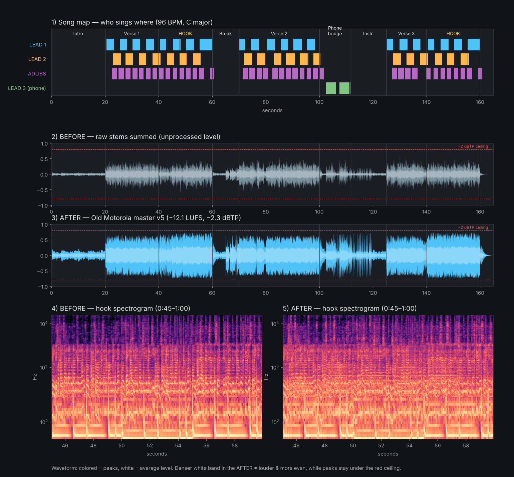

# "Old Motorola" — Mix & Master Report (v5)

**Status:** v5 passed the full 7-pass quality-control gauntlet **3 clean rounds in a row (37/37 checks each)**.
Per the Pro Mix & Master rules it stays **"draft, not final" until the artist listens and approves.**

---

## 1. Song facts

| | |
|---|---|
| Tempo | **96 BPM** (high confidence, measured on the beat) — 1 bar = 2.5 s |
| Key | C major (medium confidence; runner-up F major). Tuning A4 ≈ 437 Hz (−10 cents) |
| Length | 2:45.04 (master) |
| Genre / vibe | Melodic rap, Post Malone-type beat ("Leave Me Alone" type beat, prod. Fantom x IOF) |

**Section map**

| Time | Section | Notes |
|---|---|---|
| 0:00–0:20 | Intro | beat only |
| 0:20–0:40 | Verse 1 | LEAD 1 ↔ LEAD 2 call-and-response, adlibs in between |
| 0:40–1:00 | **Hook** | vocals enter on the beat breakdown |
| 1:00–1:10 | Break | |
| 1:10–1:40 | Verse 2 | |
| 1:43–1:51 | Telephone bridge | LEAD 3 (phone effect) alone |
| 1:51–2:05 | Instrumental | |
| 2:05–2:20 | Verse 3 | |
| 2:20–2:40 | **Final hook** | a copy-paste of the first hook (see Honest limits) |

## 2. Mix plan

- **Intent:** dark, melodic, vocal-forward. The voice carries the song, so it sits clearly on top of the beat but inside it.
- **Arrangement discovery:** LEAD 1 and LEAD 2 are **not doubles**. They trade lines (call-and-response), so both are treated as lead vocals (LEAD 2 1 dB under LEAD 1). Adlibs fill the gaps.
- **Top problems found:**
  1. The vocal stems came with **effects already printed on them**: an echo about 300 ms after each phrase and a reverb tail of about 1 s. So added reverb and delay are kept light, so the words don't wash out.
  2. **Very spiky vocals** (consonant peaks about 19 dB above the average level). This made the master hard to get loud cleanly.
  3. The beat is a **lossy rip** (nothing above about 16 kHz) and its 808 (about 43 Hz) **barely translates to phone speakers**.
- **Loudness target:** about −12 LUFS integrated (hooks about −10.4), with true peak ≤ −2.0 dBTP. Chosen so the limiter stays under 4 dB on the loudest hits (see section 4).

## 3. Every process, with settings and reasons

### LEAD 1 and LEAD 2 (same chain)
| # | Stage | Settings | Why |
|---|---|---|---|
| 1 | Gain stage | active RMS to −18 dBFS | puts compressors in their sweet spot |
| 2 | High-pass | 80 Hz, 18 dB/oct | removes rumble; lowest sung note is B2 (123 Hz), so the chest stays |
| 3 | Cleanup EQ | L1: −2.5 dB @ 433 Hz (Q6), −1.5 @ 579 (Q6); L2: −3.5 @ 1007 Hz (Q6), −1.5 @ 576 (Q6); both −1.5 @ 300 Hz (Q1) | rings that stayed **fixed in every section** (checked section by section, so they aren't melody), plus a broad mud cut |
| 4 | Dynamic EQ | 4.5 kHz, Q3, acts about 17% of the time | tames harshness only when it flares |
| 5 | Fast comp (1176-style) | −15 dB thr, 6:1, 1 ms / 50 ms | catches spikes |
| 6 | Smooth comp (LA-2A-style) | −24 dB thr, 2.5:1, 15 / 350 ms, soft knee | evens phrases (about 5 dB average total) |
| 7 | De-esser | 5–8 kHz, acts about 15% of the time (only S/T/CH) | sibilance |
| 8 | Tone EQ | +1 dB @ 3.2 kHz (Q1), +0.5 dB shelf @ 10 kHz | presence. **Reduced from +2 / +1.5 in v4** after QC measured the vocal too bright |
| 9 | Saturation | 6 dB drive, 25% blend, 4x oversampled | harmonics so the voice cuts through on phones |
| 10 | 2nd de-esser | 5.5–9 kHz, max 4 dB, acts about 7% | catches S brought back by saturation |
| 11 | Volume rider | ±3 dB phrase automation | phrase spread 4.4 → 3.2 dB |
| 12 | Peak limiter | −7.5 dBFS, 4x oversampled, latency-compensated | shaves 1 ms consonant spikes (acts about 12% of the time, about 1 dB) |

### Adlibs
High-pass 150 Hz; −2 dB @ 253 Hz (fixed ring); −1.5 dB @ 3 kHz; low-pass 10 kHz (darker, sits behind the lead); **pan rebalanced** from 10.9 dB left to about 5 dB left (still clearly left, no longer lopsided); dynamic EQ @ 3 kHz; same compressors; harder de-essing; more grit (9 dB drive, 35%); rider; peak limiter. Level: **7 dB under the lead** (doc range is 4–8).

### LEAD 3 (telephone)
Kept the artist's phone effect and tightened it: high-pass 300 Hz, low-pass 5.5 kHz, +1 dB @ 1.5 kHz, compressors, grit (9 dB, 40%), rider ±2 dB, peak limiter.

### Effects (all timed to 96 BPM)
| Effect | Settings | Notes |
|---|---|---|
| Shared plate reverb | decay 1.25 s (= half note), pre-delay **39.06 ms (= 1/64)**, return EQ 350 Hz–8 kHz, ducked 3 dB by the leads, return −18 dB | one "room" for everyone; adlibs send +2 dB more. Kept low because reverb is already printed on the stems |
| Adlib delay | **1/8 dotted = 468.75 ms**, ping-pong, feedback 0.3, filtered 400 Hz–5 kHz, **ducked 10 dB** by the leads | echoes bloom only in the gaps |
| Lead throws | **1/4 = 625 ms** on the last word before each real gap: 0:59.9, 1:40.7, 1:51.6, 2:40.0 | mid-hook throws were skipped on purpose: LEAD 1 and LEAD 2 hand off in under 250 ms, so a throw would land on the other lead's words |

### Beat
| Stage | Settings | Why |
|---|---|---|
| Vocal pocket | dynamic −2.5 dB @ 2.8 kHz (Q0.9), **mid channel only**, triggered by the lead vocals | carves a lane for the words only while they sing; the beat's width is untouched |
| Low-mid | −1.2 dB @ 320 Hz | room for the vocal's body |
| Soft clip | −1.5 dB on the top peaks, 4x oversampled | gentle density on kick/808 peaks (average level change 0.1 dB) |
| 808 harmonics | saturated harmonics of the sub (150–900 Hz) blended at −10 dB | phone-speaker translation went from 0.23 → 0.37 (the original beat itself scored 0.23) |

### Automation
Hooks: lead vocals +1.5 dB, adlibs +2.5 dB, beat +0.5 dB. Mastering: verses −1 dB **after** the limiter (pure volume, so it cannot add peaks). Hook lift **+1.5 LU**.

### Mix bus and master
1. Bus gain-staged to −6 dBFS peak, then glue compressor 2:1, 20 / 150 ms → **1.7 dB average** gain reduction.
2. Mid/side: everything below **120 Hz mono**; +1 dB mid-only shelf @ 10 kHz (kept modest because the beat is lossy).
3. 20 Hz DC-block high-pass, −1 dB @ 350 Hz broad (the mix's low-mids sat 2.1 dB above its mids).
4. 4x-oversampled lookahead limiter, ceiling −2.3 (lands at −2.3 dBTP).
5. 12 Hz zero-phase DC blocker (the limiter itself created a tiny DC offset), verse automation, trim with a 0.4 s fade after the last echo.

## 4. Before → after

| | Rough (raw stems summed) | **Master v5** |
|---|---|---|
| Integrated loudness | −18.9 LUFS | **−12.1 LUFS** |
| Max short-term loudness | −17.3 LUFS | **−10.0 LUFS** |
| True peak | −3.0 dBTP | **−2.3 dBTP** |
| Peak-to-loudness | 15.9 dB | **9.8 dB** |
| Loudness range | 13.9 LU | 11.8 LU |
| Stereo correlation / mono fold | 0.88 / −0.27 dB | 0.86 / −0.31 dB |
| Limiter on the loudest 1% of hits | — | **3.8 dB** (median 0.1 dB) |

**Why −12 and not −8 or −9?** At −10.5 the limiter was shaving 6–8 dB off the loudest hits, which breaks the rule of 3–4 dB maximum and means flattened drums. After the vocal fixes, −12 integrated (hooks at −10.4) is the loudest version that stays at 3.8 dB. Spotify, YouTube and TIDAL turn everything down to about −14 anyway, so this master loses only about 2 dB there and keeps its punch. Masters crushed to −8 lose about 6 dB and arrive flatter. **A louder version can be made if you want it**, with that trade-off stated.

**Tonal shift vs. the rough** (upper-mid +2.1, high +4.0, air +3.6 dB): the vocal now sits about 2 LU further forward over a dark beat, and the compression brings up consonants. Measured on the vocal alone at matched loudness, the presence lift is +2.5 dB and the S-range +2.2 dB, both inside the doc's +1 to +3 dB spec.

## 5. Quality-control results

| Round | File checked | Result |
|---|---|---|
| Dev round (v3) | 24-bit WAV | 30/36: failed timing, 808-on-phone, plus 4 badly designed checks |
| Dev round (v4) | 24-bit WAV | 35/36: vocal measured too bright → tone EQ reduced |
| **Round 1 (v5)** | 24-bit WAV | **37/37 PASS** |
| **Round 2 (v5)** | 16-bit WAV | **37/37 PASS** |
| **Round 3 (v5)** | MP3 320, decoded | **37/37 PASS** |

The checks cover: no clipping, DC, clicks or dead air; correct format and length; delay and pre-delay match the BPM math; beat and vocals not shifted (0 samples); lead +1.9 LU over the beat; adlibs 7 dB under; hook lift +1.5 LU; phrase consistency; presence within spec; no harsh flare-ups; no mud or boom; sibilance tamed; translation sims (phone, earbuds, car, club, laptop, mono, low volume) with words 8.9–9.4 dB clear in 1–4 kHz; 808 audible on phone; −12.1 LUFS; −2.28 dBTP; MP3 and AAC encodes under 0 dBTP (−2.27 and −2.23). Full per-check results are in `session/settings/qc_R*.json`.

**Fixed along the way (version history):**
- **v1:** glue compressor hit far too hard because the bus wasn't gain-staged → fixed.
- **v2:** vocal spikes made the limiter work too hard → oversampled vocal peak limiters added.
- **v3:** limiter still 6–8 dB on hits → harder fast-compressor stage, beat soft clip, loudness target lowered to fit the rule.
- **v4:** vocal peak limiters were delaying the vocal 0.48 ms → latency compensation on; 808 harmonics added for phones.
- **v5:** vocal measured +3.4 dB presence / +4.1 dB S-range (over spec) → tone EQ reduced to +1 / +0.5 dB.

## 6. Honest limits (what the source prevents)

- **The beat is a lossy rip** (a "FREE … type beat" download): nothing above about 16 kHz, so true top-end "air" can't be restored, only hinted at. The vocal stems are also band-limited at about 16 kHz.
- **Vocal stems have printed effects** (echo and reverb). They can't be removed, so the space is partly decided by the original export.
- **The final hook (2:20) is a copy-paste of the first hook, placed 10 ms late** against the beat. That is under the 20–30 ms threshold for fixing, so it was left as performed.
- **I can't hear.** Every decision here was measured, not listened to. Your ears are the final judge.
- **No clean/radio edit:** I can't know which words need muting without listening, and I didn't send your vocals to any outside transcription service, to keep your music private.

## 7. What would make it even better

1. **Buy or lease the beat's WAV (or trackout stems)** from the producer. This is the biggest upgrade: full top end, and separate drums/808 for real kick-808 control.
2. **Export the vocals dry** (effects off), plus a separate copy with your effects. That gives full control of the space and timing.
3. Re-export the stems at 24-bit.
4. Send 1–3 reference songs you want it to sound like, and I'll match loudness, low end and vocal level against them.
5. Tell me the timestamps of any explicit words and I'll make the clean/radio edit.

## 8. Files

| File | Use |
|---|---|
| `Old_Motorola_Master_v5_24b-44k.wav` | **Main master**: upload this to your distributor |
| `Old_Motorola_Master_v5_16b-44k.wav` | 16-bit dithered, for anywhere that requires 16-bit |
| `Old_Motorola_Master_v5_320k.mp3` | sharing and quick listening |
| `Old_Motorola_Instrumental_v5_24b-44k.wav` | performances, sync (same master chain) |
| `Old_Motorola_Acapella_v5_24b-44k.wav` | remixes (same master chain) |
| `Old_Motorola_TV_Track_v5_24b-44k.wav` | beat plus adlibs, no lead, for live/TV |
| `Old_Motorola_Unmastered_Mix_v5_24b-44k.wav` | mix at −4 dBFS peak, for future remasters |
| `Old_Motorola_AB_Hook_RoughVsMaster.mp3` | **listen first**: 15 s of the raw hook, a pause, then the master hook, **at equal loudness** |
| `Old_Motorola_Before_After.png` | song map, waveforms, spectrograms |
| `session/` | every script and setting, so any version can be rebuilt |
| `versions/` | earlier master MP3s (v3, v4) |

All alternate versions went through the exact same bus and master settings as the main. Null test: re-rendering the main through that fixed chain leaves a −86.6 dBFS residual, so they match.

**Listen for:** 0:40 (hook entry: vocal lane and lift), 0:59.9 (first delay throw into the break), 1:43 (telephone bridge), 2:40 (final throw and fade). Try it on your phone speaker too.
