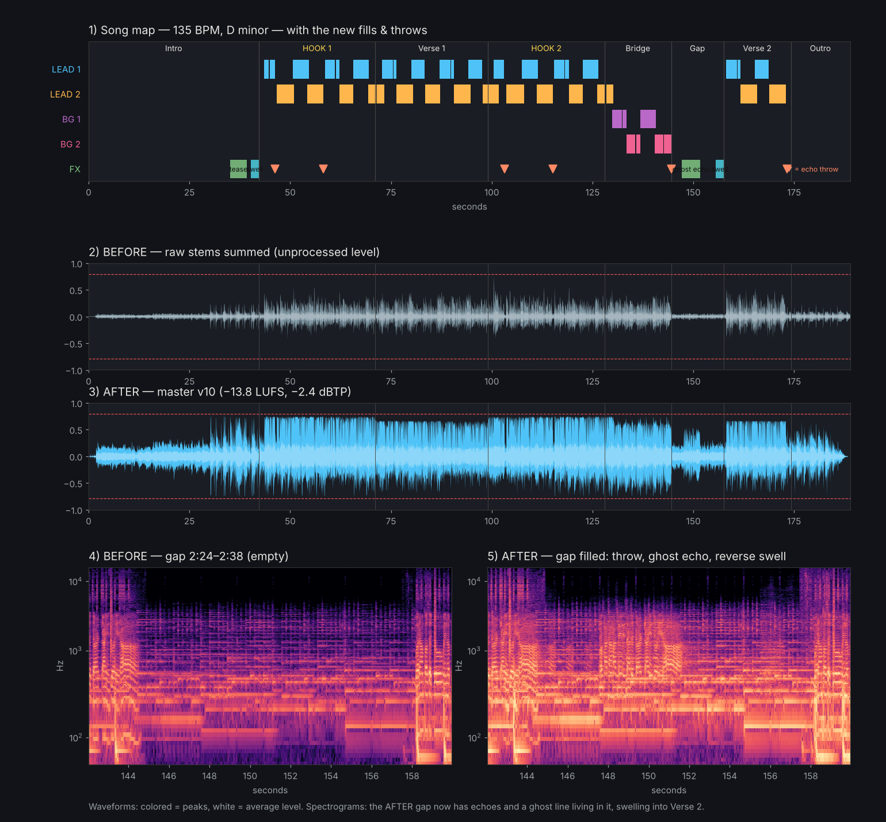

# "What I'm Posed To Do" — Mix & Master Report (v10)

**Status:** v10 passed the 7-pass QC gauntlet **3 rounds in a row (24-bit WAV, 16-bit WAV, decoded MP3): 39/40 checks, 0 failures, 1 source-limit explained below.**
It stays "draft, not final" until you listen and approve.

## 1. Song facts

| | |
|---|---|
| Tempo | **135.000 BPM** (verified sample-exact over 96 bars). 1 bar = 1.778 s |
| Key | D minor (relative F major); the 808 sits on B♭1 (58.5 Hz) |
| Length | 3:08.8 (the beat ran to 4:03 with no vocals after 2:53, so it now ends with an 8-bar outro and a 4-bar fade) |
| Beat | "Hold On" type beat (Post Malone × Juice WRLD type), a **160 kbps YouTube rip** |

| Time | Section | What's there |
|---|---|---|
| 0:00–0:42 | Intro | beat; **new:** hook tease at 0:35, reverse swell into 0:42 |
| 0:42–1:11 | **Hook 1** | LEAD 1 ↔ LEAD 2 call-and-response, stereo doubler |
| 1:11–1:39 | Verse 1 | drier and closer; second half over the beat breakdown |
| 1:39–2:08 | **Hook 2** | a re-edit of Hook 1 (same melody), doubler |
| 2:08–2:24 | Bridge | BG 1 and BG 2 in a round, panned left/right |
| 2:24–2:37 | Gap | **new:** half-note throw, ghost echo of the last BG line, reverse swell |
| 2:37–2:54 | Verse 2 | |
| 2:54–3:09 | Outro | final throw on your last word, beat fades over 4 bars |

## 2. Mix plan
- **Dry vocals:** no effects were printed on the stems, so every echo and reverb was built from scratch and timed to 135 BPM.
- **Your requests:** perfect timing, echo throws and delays, make it pop, fill the empty gaps. I answered each with measured, grid-locked moves.
- **Problems found:** an extremely spiky beat (a snare/clap with 23–27 dB crest), an 808 that's a near-pure sine (phone speakers can't reproduce it), a lossy beat (nothing above 16.5 kHz), and long empty stretches (a 42 s intro, an 8-bar gap, 70 s of unused beat).

## 3. Processing

### Vocals (LEAD 1, LEAD 2: same chain fitted to each)
5 ms fades on all 27 region edges → gain to −18 dBFS RMS → **high-pass 65 Hz** (your lowest sung note is F2 at 87 Hz) → static cuts on rings that stayed fixed across sections (L1: 350 / 468 Hz; L2: 331 / 487 Hz), −1.5 dB @ 300 Hz → dynamic EQ (L1 3.5 kHz, L2 3.16 kHz; acts about 20% of the time) → fast compressor (−15 dB, 6:1) then smooth compressor (−24 dB, 2.5:1), 6.5–7.2 dB total → de-esser (5–8 kHz, S/T/CH only) → +1 dB @ 3.2 kHz, +0.5 dB air → saturation (6 dB, 25%) → second de-esser → phrase rider (spread 3.0 → 2.3 dB) → oversampled peak limiter (−7.5 dBFS, latency-compensated).
Level: about **+2.9 LU over the beat** in full sections. Hooks +1.5 dB; −1.5 dB where the beat drops out, so your voice doesn't jump out.

### BG 1 / BG 2
High-pass 150 Hz, cuts at their fixed rings (BG1 5.6k; BG2 231 / 1157 / 5566 Hz), −1.5 dB @ 3 kHz, low-pass 11 kHz, same dynamics, harder de-ess, more grit. **Panned 35% left / 35% right** so the round spreads across the speakers. Sits 2.1 dB under the lead level (they carry the bridge).

### Effects: all from 135 BPM (exact sample counts)
| Effect | Setting |
|---|---|
| Shared plate | decay **1 bar (1.78 s)**, pre-delay **1/64 = 27.78 ms**, 350 Hz–8 kHz, ducked 4 dB by the vocals; +2.5 dB in sparse sections |
| Ambience delay | **1/4 = 444.44 ms** ping-pong, **ducked 12 dB** while anyone sings, so it fills the micro-gaps between your call-and-response lines |
| BG delay | **1/8 dotted = 333.33 ms** ping-pong, ducked 10 dB |
| Throws | 1/8d at **0:46.2 / 1:43.2** (the 1-beat pocket after hook line 1, matching in both hooks); 1/2 note (**888.89 ms**) at **0:58.3** (into the break), **2:24.5** (into the gap) and **2:53.2** (final word); 1/4 at **1:55.2** |
| Hook doubler | ±7 cents, 13 / 19 ms, hard left/right, **only in the hooks**, so they open up wider |
| Intro tease | Hook 2's first line, phone-filtered (500 Hz–3.2 kHz), placed **exactly 36 bars earlier** (0:35.05), with hall and 1/4 echo |
| Ghost echo | BG 2's last line, phone-filtered, **exactly 4 bars later** (2:27.1) in the gap |
| Reverse swells | the hall tail of your entry words, reversed, rising into **0:42.23** and **2:37.47** |

### Beat
Vocal-triggered pocket (−2.5 dB @ 2.8 kHz, mid channel, only while you sing) → −1.5 dB @ 300 Hz → 808 harmonics (−7 dB) → gentle 808 compressor (<150 Hz, evens notes 6.2 → 5.2 dB) → two-band transient clip (snare/clap −6 dB, kick −2.5 dB) → outro fade.

### Bus and master
Glue 2:1 with a **sidechain high-pass at 600 Hz** so the 808 can't make it pump (1.4 dB) → mono below 120 Hz, +0.5 dB mid air → 4x-oversampled limiter (3.8 dB on the loudest 1% of hits, median 0.0) → DC block → verses −1 dB after the limiter (hook lift +1.3 LU).

## 4. Before → after
| | Rough | **Master v10** |
|---|---|---|
| Integrated | −23.3 LUFS (A/B level) | **−13.8 LUFS** |
| Max short-term | — | **−11.3 LUFS** (hooks −11.7 to −12.1) |
| True peak | — | **−2.4 dBTP** (MP3 −2.31, AAC −2.19) |
| Correlation / mono loss | — | 0.95 / −0.12 dB |

**Why −13.8 LUFS?** Louder targets made the limiter crush this beat by 7–8 dB. I tried transient clipping, 808 compression and a sidechained glue, then chose clean over loud. Spotify plays everything at −14 LUFS, so this master is barely touched there and keeps its punch. The song also has long quiet sections, which pull the integrated number down even though the hooks are about as loud as "Old Motorola"'s verses. **A louder version is possible if you want it**, with the trade-off stated.

## 5. QC
| Round | File | Result |
|---|---|---|
| Dev (v6) | 24-bit | 35/39: flagged a "30 ms timing" issue, lead too loud, 808 on phone |
| **R1 (v10)** | 24-bit WAV | **39/40, 0 fail, 1 source-limit** |
| **R2 (v10)** | 16-bit WAV | **39/40, 0 fail, 1 source-limit** |
| **R3 (v10)** | MP3, decoded | **39/40, 0 fail, 1 source-limit** |

**Source-limited: the 808 on phone speakers.** Translation went 0.17 → 0.26 (+51% over the original beat), short of my 0.3 target. I tried 7 fixes: three enhancer strengths, sidechain at 150 / 600 / 1000 Hz, and sub clipping at 3 / 5 dB. Pushing further added low-mid mud over your voice. Fix at the source: the beat's trackout stems, or an 808 sample with more harmonics.

**About timing ("perfectly timed"):** Hook 2 is a re-edit of Hook 1 placed 23 ms later. I measured both against the beat grid before touching anything. **Hook 2 lands right on the grid (+1.8 ms) and Hook 1 pushes slightly ahead (−22 ms, a natural singer's push).** Both are natural, so per your doc I did **not** move your vocals. Every effect is grid-locked: delays are exact sample counts, and the tease and ghost moved by whole bars on a beat verified at exactly 135.000 BPM.

## 6. Honest limits
- **The beat is a 160 kbps YouTube rip**: nothing above 16.5 kHz, and some lossy smear. Buying the WAV or trackouts is the biggest upgrade.
- The 808 on phones (above).
- **I added creative content** (the intro tease, ghost echo and swells), because you asked to fill the gaps. If any of it isn't your vision, use the **No Fills** master: same everything, minus those.
- **I can't hear.** Everything was measured; your ears decide.

## 7. Even better next time
Buy the beat's WAV or trackout stems. Keep the vocals dry like you did, which was perfect for this. Send 1–3 reference songs. Tell me any lines you want throws on and I'll add them by timestamp.

## 8. Files
| File | Use |
|---|---|
| `…_Master_v10_24b-44k.wav` | **main master** for your distributor |
| `…_Master_v10_16b-44k.wav` / `…_Master_v10_320k.mp3` | 16-bit / sharing |
| `…_Master_NoFills_v10_24b-44k.wav` (+ MP3) | same master **without** the tease, ghost echo and swells |
| `…_Instrumental_v10`, `…_Acapella_v10`, `…_TV_Track_v10` | alternates through the identical chain (null test −89.4 dBFS) |
| `…_Unmastered_Mix_v10_24b-44k.wav` | for future remasters |
| `…_AB_IntroIntoHook_RoughVsMaster.mp3` | **listen first**: 0:33–0:50 rough, a pause, then master, at equal loudness |
| `…_Before_After.png` | song map with every fill and throw marked |
| `session/` | all scripts and settings |

**Listen for:** 0:35 (tease), 0:42 (swell into Hook 1), 0:46 and 0:58 (throws), 1:43 (Hook 2 doubler width), 2:24–2:37 (gap fill), 2:53 (final throw into the outro).
